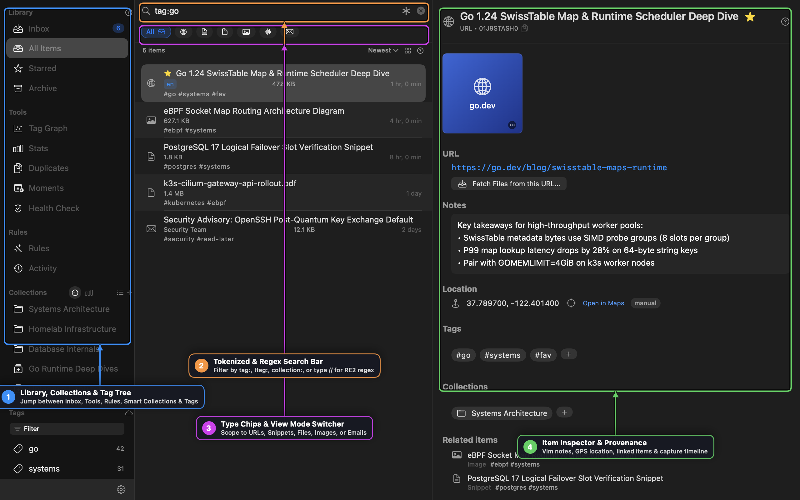
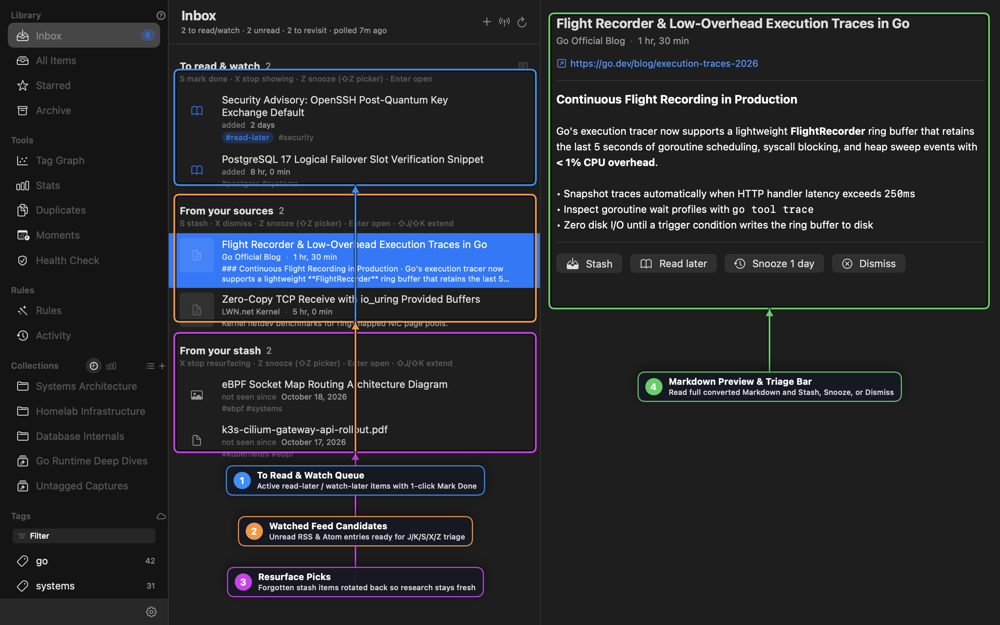
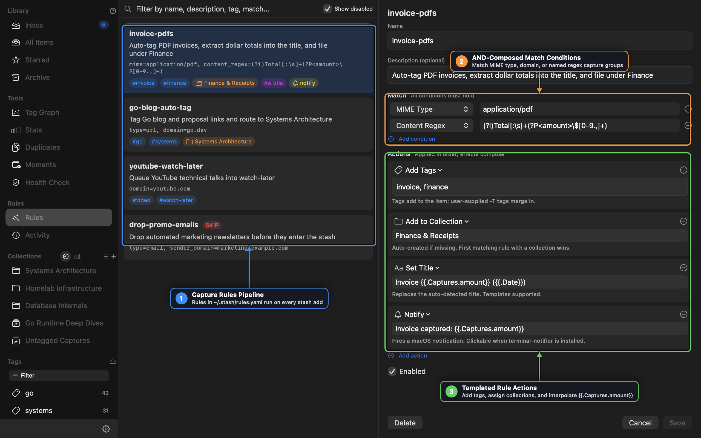
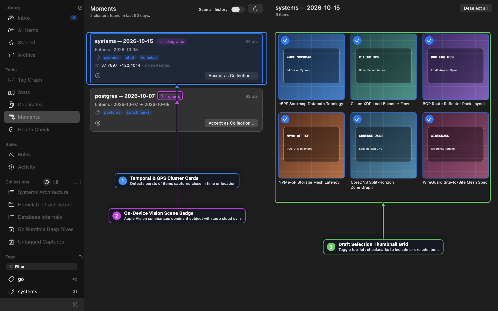

# Stash for macOS — User Guide

**Stash** is a local-first, content-addressed personal knowledge base, media library, and triage inbox for macOS. Every link, snippet, document, image, audio/video recording, and email you capture is hashed with **SHA-256**, indexed in SQLite with **FTS5** full-text search, and stored locally under `~/.stash` so your research stays fast, private, and scriptable from both the native macOS workbench and the `stash` CLI.

---

## 1. Getting Started & Workbench Layout

Stash organizes your library into a three-pane native macOS workbench:

1. **Sidebar (Left Pane)** — Jump between **Library** views (`Inbox`, `All Items`, `Starred`, `Archive`), **Tools** (`Tag Graph`, `Stats`, `Duplicates`, `Moments`, `Health Check`), **Rules** (`Rules`, `Activity`), **Collections** (a unified strip of Static and Smart Collections capped at your 3 most recent and 3 most frequent sets, with an **All (N) ▸** popover for the full list), and **Tags** (toggleable between a filterable list and an interactive tag cloud).
2. **Item List / Active Tool (Middle Pane)** — Displays the tokenized search bar (`⌘F`), single-click item type filter chips, sort controls, view-mode switcher (**List**, **Grid**, **Gallery**), and the active item rows or tool cards.
3. **Inspector & Detail View (Right Pane)** — Displays the selected item's hero thumbnail or inline media player, metadata, Vim-enabled notes editor, GPS location map, tags, collections, related & linked items, extracted full text, and provenance timeline.

### Quick Navigation & Global Shortcuts

| Shortcut | Action |
| :--- | :--- |
| `⌘K` | Open the **Quick Search** command palette from anywhere in the app |
| `⌘F` | Focus the inline tokenized search bar in the item list |
| `A` / `⌘N` | Open the **Add Item** sheet (`URL`, `Snippet`, or `File`) |
| `⌘[` / `⌘]` | Navigate **Back** and **Forward** through selection history |
| `⌘R` | Refresh items, tags, collections, and feed candidates |
| `⌘⇧/` (`⌘?`) | Toggle interactive **Contextual Help** badges across the UI |
| `⌘,` | Open **Settings** (Appearance, Capture, AI Identify, Android Companion Pairing) |

> [!TIP]
> **Global Menu Bar Capture**: Stash also runs a lightweight menu bar item that watches your clipboard (when enabled) and provides 1-click **Stash Clipboard**, **Grab Current Selection**, and **Recent Captures** actions from any macOS application.

---

## 2. Capturing & Adding Items

Stash supports six ways to bring items into your library:

1. **Add Sheet (`A` or `⌘N`)** — Choose **URL**, **Snippet**, or **File**, assign initial tags (`MultiTagField` with Stash-model auto-suggest) and a collection, and optionally attach notes.
2. **Drag and Drop** — Drag files, images, PDFs, audio/video files, `.eml` messages, or URLs from Finder, Safari, or Mail directly onto the item list, onto a **Collection** row in the sidebar (to capture and file in one motion), or onto a **Tag** row in the sidebar.
3. **Fetch Media from URL (`link.badge.plus` Toolbar Button)** — Paste any webpage URL to discover and batch-capture embedded images, videos, or documents on that page.
4. **macOS Services & Share Sheet** — Highlight text or a URL in any app and trigger **Stash Selection** from the macOS Services menu or Share menu.
5. **Browser Bookmark & History Importers** — Use **File → Import Browser Bookmarks…** or **File → Import Browser History…** to bulk-import from Safari, Chrome, Arc, Brave, or Firefox with automatic deduplication.
6. **Watched RSS/Atom Feeds** — Subscribe to feeds in the **Inbox** and press `S` on any candidate to stash it into your permanent library.

### Item Types & Automatic Processing

| Type | What Stash Extracts & Stores |
| :--- | :--- |
| **URL** | Fetches the page HTML, extracts readable article text into the FTS5 index, scores and caches a canonical 512px sRGB thumbnail (`og:image`, `twitter:image`, JSON-LD, or largest qualifying ``), and resolves direct streams or YouTube/Vimeo embeds. |
| **Snippet** | Stores plain text, code blocks, or Markdown notes directly in the content-addressed filestore with full-text indexing. |
| **File** | Copies the file into `~/.stash/files` (content-addressed by SHA-256), indexes PDF/document text, generates QuickLook thumbnails, and inspects `.zip`/`.tar.gz` archives inline. |
| **Image** | Stores the original image, generates a saliency-cropped thumbnail via Apple Vision, extracts **EXIF** camera/lens metadata and **GPS coordinates**, and runs on-device OCR text recognition. |
| **Email** | Parses `.eml` (`message/rfc822`) messages, indexing `From`, `To`, `Subject`, date headers, plain/HTML bodies, and attachments. |

---

## 3. Unified Triage Inbox

The **Inbox** is Stash's keyboard-driven triage surface for processing new reading/watching material without cluttering your permanent library. It combines three live sections in a single view:

1. **To Read & Watch** — Every stashed item tagged `read-later` or `watch-later`. Once you finish an article or video, press `S` (or click the checkmark) to strip the triage tag and graduate the item out of the queue while keeping it in your permanent library.
2. **From Your Sources (Watched Feeds)** — Unread entries polled from your subscribed RSS and Atom feeds, complete with cached HTML-to-Markdown previews in the right-hand inspector.
3. **From Your Stash (Resurface Picks)** — Older, high-value items from your library that you haven't viewed recently, rotated back into view so long-term research stays fresh.

### Single-Key Inbox Triage Shortcuts

| Key | In "To Read & Watch" | In "From Your Sources" | In "From Your Stash" |
| :--- | :--- | :--- | :--- |
| `J` / `K` | Move cursor down / up | Move cursor down / up | Move cursor down / up |
| `⇧J` / `⇧K` | Extend multi-selection | Extend multi-selection | Extend multi-selection |
| `S` | **Mark Done** (remove `read-later`/`watch-later`) | **Stash** item + tag `read-later` | *(Already stashed)* |
| `X` | Stop showing in queue | **Dismiss** feed entry | **Stop resurfacing** item |
| `Z` | **Snooze** 7 days | **Snooze** 1 day | **Snooze** 7 days |
| `⇧Z` | Open custom **Snooze Picker** (`1h` – `1w`) | Open custom **Snooze Picker** | Open custom **Snooze Picker** |
| `Enter` / `O` | Open item in default handler | Open article URL in browser | Open item in default handler |

---

## 4. Searching, Token Filters & RE2 Regex

Stash provides two complementary search surfaces:

- **Inline Filter Bar (`⌘F`)** at the top of the item list for scoping the current view.
- **Quick Search Palette (`⌘K`)** for instant keyboard-first jumping, global `/` slash commands, and saved search history.

### Search Token Grammar

Tokens can be combined freely with full-text search terms (all tokens `AND` together):

| Token Syntax | Meaning | Example |
| :--- | :--- | :--- |
| `tag:<name>` | Require tag `<name>` | `tag:systems tag:go` |
| `!tag:<name>` or `-tag:<name>` | Exclude items carrying `<name>` | `tag:go !tag:archived` |
| `^tag:<name>` | Exclusive tag match (items with *only* that tag) | `^tag:inbox` |
| `collection:<name>` | Scope to a specific collection | `collection:"Homelab Infrastructure"` |
| `type:<kind>` | Scope to `url`, `snippet`, `file`, `image`, or `email` | `type:image` |
| `//<pattern>` | **RE2 Regular Expression** search across titles, URLs, notes & extracted text | `//(?i)p99\s+latency` |

### Stash Auto-Suggest Interaction Model

Every filter and tag input in Stash uses a deterministic, non-intrusive auto-suggest model:

- **`Tab` (dropdown hidden)** — Opens the suggestion dropdown at the cursor without mutating your text.
- **`Tab` / `↓` (dropdown visible, multiple items)** — Advances the highlight through candidates without overwriting what you typed.
- **`Tab` (dropdown visible, single match)** — Completes that token in place and chains directly into value suggestions.
- **`Enter`** — Commits the highlighted suggestion (keys insert without a trailing space and immediately open value suggestions; values insert with a trailing space and close the dropdown).
- **`Esc`** — Dismisses the dropdown first; a second `Esc` clears the field.

---

## 5. Organizing: Tags, Smart Collections & Links

### Tags & Tag Graph

- **Hierarchical & Flat Tagging**: Add tags inline in the detail pane (`+`), via right-click context menus, or by dragging items onto a tag in the sidebar.
- **Starred Tag (`#fav`)**: Clicking the star icon in the detail header toggles the reserved `fav` tag and surfaces the item under **Starred** in the sidebar.
- **Tag Graph (`Tools → Tag Graph`)**: Visualizes co-occurrence relationships across your library as an interactive force-directed network. Click any node to pivot into items sharing that tag cluster.

### Static & Smart Collections

Stash merges **Static Collections** (hand-curated folders) and **Smart Collections** (live saved queries backed by `SavedSearch` rules) into a single **Collections** sidebar section:

- **Recent & Frequent Strip**: To prevent sidebar bloat, Stash displays up to **3 Recent** and **3 Frequent** collections directly in the sidebar and provides an **All (N) ▸** popover with instant search for your entire collection list.
- **Smart Collections (`sparkles.rectangle.stack`)**: Define live filters by query string, item type, required/excluded tags, or untagged state. Any newly captured item matching the criteria appears automatically.
- **Merge & Add-To Workflows**: Right-click any collection in the sidebar to merge multiple collections into a survivor or copy items between collections.

### Bidirectional Item Links

Link related items together (for example, connecting a benchmark diagram to the architecture RFC it illustrates) using the **Linked Items** section in the detail pane. Each link carries an optional directional label (`benchmarks`, `references`, `supersedes`) and allows 1-click traversal between connected items.

---

## 6. Capture Rules & Automation

Every time an item enters Stash—whether from the macOS app, the menu bar, watched feeds, or `stash add` on the CLI—it runs through the **Capture Rules Engine** (`~/.stash/rules.yaml`).

### Match Conditions (AND-Composed)

A rule fires only when **all** configured match conditions hold:

- **Item Type** (`url`, `snippet`, `file`, `image`, `email`)
- **Domain / Sender Domain** (e.g., `go.dev`, `youtube.com`, `github.com`)
- **MIME Type** (e.g., `application/pdf`, `image/png`, `audio/*`)
- **URL Regex / Title Regex / Content Regex** — Full RE2 regular expressions with support for **named capture groups** (`(?P<amount>\$[0-9.,]+)`).
- **File Path / Extension** globs

### Rule Actions & Template Interpolation

When a rule matches, its actions execute in order and compose across all matching rules:

- **Add Tags / Remove Tags** — Automatically tag incoming items (supports `{{.Captures.<name>}}` interpolation).
- **Add to Collection** — Route the item into a collection (auto-creating the collection if needed).
- **Set Title** — Rewrite the item's title using Go template variables (`{{.Title}}`, `{{.Domain}}`, `{{.Date}}`, and named regex captures like `{{.Captures.amount}}`).
- **Set Thumbnail** — Trigger `auto` extraction or bind a custom thumbnail URL/path.
- **Notify** — Fire a native macOS notification with custom templated text.
- **Run Shell Command** — Execute a local script or webhook with item metadata passed in environment variables.
- **Skip Capture (`SKIP`)** — Drop unwanted items (such as automated marketing emails) before they enter your database.

> [!NOTE]
> **Rule Activity & Backfill**: Open **Rules → Activity** in the sidebar to inspect a live audit log of every rule firing, or click **Apply to Existing Items** on any rule to backfill historical items in your library.

---

## 7. Moments: Temporal, GPS & Vision Clustering

**Moments** (`Tools → Moments`) automatically discovers bursts of related activity across your library—such as a whiteboard session, an architecture workshop, or a field trip—by clustering items captured close together in **time** and **GPS location**.

- **On-Device Apple Vision Scene Badges**: Stash runs Apple's on-device `VNClassifyImageRequest` across image thumbnails in each cluster to compute a dominant scene label (e.g., `✨ diagrams`, `✨ charts`, `✨ documents`) with **zero cloud API calls**.
- **Draft Selection Grid**: Select any Moment card to inspect its items in a visual grid. Toggle the top-left checkmarks on individual tiles to include or exclude specific items.
- **1-Click Promote to Collection**: Click **Accept as Collection…** to turn the curated cluster into a permanent named collection.

---

## 8. Item Detail, Media Playback & Audio X-Ray

Selecting any item opens the **Item Detail Inspector**, which adapts to the item's media type:

- **Inline AVKit Video & Audio Player**: Local video/audio files (`video/*`, `audio/*`), direct stream URLs, and YouTube/Vimeo links render an inline player right at the top of the inspector. Press `Space` to play/pause.
- **Audio X-Ray & Multi-Track Remixing**: For multi-track recordings and interviews, expand the **Audio X-Ray** workbench to inspect per-speaker waveforms, speaker diarization markers, and real-time DSP remixing controls:
  - **Adaptive Switcher vs. Simple Linear Mix**
  - **Noise Floor Gate** & **Voice Activity Threshold**
  - **Speech EQ** and per-channel gain alignment
- **Interactive Hero Thumbnail**: Drag a replacement image onto the thumbnail block, paste an image URL, pick from alternate page candidates, or click `↻` to re-fetch.
- **GPS Location & EXIF**: View camera/lens metadata and click the coordinate pill to open an interactive **Apple Maps** popover or jump to Maps.app.
- **Archive Tree Preview**: Selecting a `.zip` or `.tar.gz` file renders its internal directory hierarchy inline without extracting to disk.
- **Provenance Activity Timeline**: Expand the **Activity** section at the bottom of the inspector to see the complete lifecycle of the item—when it was captured, which Capture Rules fired, and every tag or collection change.

---

## 9. Vim Mode & Slash Commands in Notes

The **Notes** editor in the Item Detail pane and the **YAML Code Editor** in Capture Rules both support optional **Vim modal editing** and **live `/` slash commands** (configurable in **Settings → Appearance**):

- **Activating Vim Mode**: All editors start in standard macOS editing mode by default. Click the subtle `:_` watermark in the bottom-right corner of the editor (or type `/vim` at the start of a line) to enter **Vim Normal Mode** (`VIM:N`).
- **Vim Mode Badge & Cheatsheet**: While active, a top-right badge displays `VIM:N`, `VIM:I`, or `VIM:V` alongside a `?` popover cheatsheet and `×` exit button, and the first line wraps cleanly before the badge.
- **Built-in Slash Commands**: Type `/` at the start of a line to open the dynamic slash command bar (`Tab` / `↑` / `↓` to cycle, `Enter` or `Space` to execute):
  - `/vim` — Toggle Vim modal editing
  - `/uc` / `/lc` — Convert text to uppercase or lowercase
  - `/trim` — Trim leading/trailing whitespace and collapse blank lines
  - `/sort` / `/dedup` — Sort lines alphabetically or remove duplicate lines
  - `/fix` / `/sum` / `/tags` — Run on-device or configured AI text cleanup, summarization, or tag extraction

---

## 10. Library Maintenance: Duplicates, Health Check & Stats

- **Duplicates (`Tools → Duplicates`)**: Scans your library for exact SHA-256 hash matches, canonicalized URL collisions, and near-duplicate titles. Select any group to **Merge Items**—combining all tags, collections, links, and notes into the survivor item cleanly.
- **Health Check (`Tools → Health Check`)**: Verifies SQLite FTS5 integrity, checks for missing filestore blobs or orphaned thumbnails, and offers 1-click **Repair**.
- **Stats (`Tools → Stats`)**: Displays storage breakdown by item type, capture velocity over time, top domains, and tag distribution.
- **AI Identify & 1Password Secrets (`Settings → AI`)**: Configure Gemini or Claude for optional image/document identification and rule suggestions. API keys can be stored directly or referenced via **1Password `op://` secret URIs** with built-in token usage and cost tracking.
